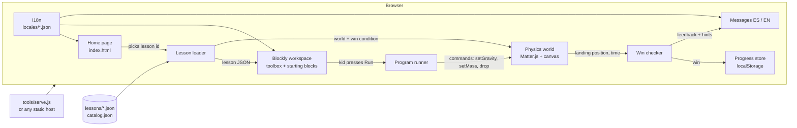

# ILO: Technical Plan

Status: Phase 8 (two new lessons, interiors, avatar animation, stamps and extras, sound) built and verified on 2026-10-27. See "Phase 8 results" at the end.

## Summary

ILO is a browser app where kids aged 8 to 13 learn physics by snapping together code blocks that control a small physics game. Each lesson is one JSON file that describes the scene, the available blocks, the starting program, the win condition and hints in Spanish and English. The app is plain HTML, CSS and JavaScript using Blockly for the blocks and Matter.js for the physics, with no framework, no build step and no server-side code. Progress is saved in the browser, and accounts come after the MVP. The MVP ships one complete lesson, "Gravity and falling objects", and the tooling that lets a non-programmer add more lessons.

## Architecture

### Components

| Component | File(s) | What it does |
|---|---|---|
| Home page | `index.html`, `js/home.js` | Lists the lessons from `lessons/catalog.json`, opens a lesson, has the ES/EN switch. |
| Lesson page | `lesson.html`, `js/lesson.js`, `js/show-error.js` | Connects the blocks, physics, drawing and messages for one lesson. |
| Translations | `locales/es.json`, `locales/en.json`, `js/i18n.js` | All app text (buttons, messages, block labels). Lesson text lives in the lesson JSON. Blockly's own menus use Blockly's official `es`/`en` files. |
| Lesson loader | `js/lesson-loader.js` | Downloads a lesson JSON, checks the required fields, and shows a plain-language error if something is wrong. |
| Block catalog | `js/blocks.js` | Defines every block ILO knows (for example "set gravity", "set mass", "drop"). A lesson picks which ones the kid sees. |
| Program runner | `js/runner.js` | Reads the blocks under "when run" in order and turns them into simple commands. It does **not** generate or `eval` JavaScript, which keeps it safe and easy to debug. |
| Physics world | `js/simulation.js`, `js/renderer.js` | `simulation.js` builds the Matter.js scene from the lesson's `world`, applies the commands and steps it with a fixed time step (same result every run). It has no browser code, so the tests run it in Node. `renderer.js` draws it on the canvas. |
| Win checker | `js/win-conditions.js` | Small set of named win-condition types (MVP: `lands_in_zone`). Returns win/lose plus which feedback message to show. Has no browser code, so it can be tested in Node. |
| Progress store | `js/progress.js` | The only file that saves or reads progress (`localStorage` today). Accounts will replace this file later (A3). |
| Libraries | `vendor/` | Exact copies of Blockly 13.4.0 and Matter.js 0.20.0, so nothing is loaded from the internet (A5). |
| Local server | `tools/serve.js` | About 40 lines of Node with no dependencies. Needed because browsers block loading JSON files straight from disk. |
| Lesson checker | `tools/check-lessons.js`, `schema/lesson.schema.json` | `npm run check` validates every lesson against the schema and reports mistakes in plain language. |
| Tests | `tests/` | Node's built-in test runner. Runs the gravity lesson's physics with no browser and confirms only the correct answer wins. |

### How they connect



### Gravity lesson design

A drone flies right at a fixed speed and carries a package. The kid's program picks the planet (gravity) and drops the package. The package keeps moving sideways while it falls, so the gravity setting decides how far it travels before landing:

- Stronger gravity means a faster fall, so the package lands sooner and closer.
- Weaker gravity means a slower fall, so the package lands later and farther.
- Mass does not change the fall. The "set mass" block is offered on purpose, to address that common misconception.

With a drop height of 8 m and a speed of 3 m/s, the ideal landing spots are Jupiter (24.79) at about 3.4 m, Earth (9.81) at about 4.8 m, Mars (3.71) at about 7.2 m and the Moon (1.62) at about 10.4 m. The delivery zone covers 6.5 to 7.9 m, so only Mars wins. The starting program uses Earth, so the kid must change it. The exact numbers are confirmed by the headless test in Phase 5.

### Decisions made in this phase

See D2 to D5 under "Decisions".

## Lesson format

A lesson is one file in `lessons/`, plus one line in `lessons/catalog.json`. Every text the kid sees is written as `{ "es": "...", "en": "..." }`, and both languages are required. Positions are in **meters**, with `x` measured from the left edge and `y` measured up from the ground.

### JSON Schema

Saved as `schema/lesson.schema.json` in Phase 4.

```json
{
  "$schema": "https://json-schema.org/draft/2020-12/schema",
  "$id": "ilo/lesson.schema.json",
  "title": "ILO lesson",
  "type": "object",
  "required": ["schemaVersion", "id", "concept", "title", "learningGoal", "intro",
               "world", "toolbox", "startingBlocks", "winCondition", "hints", "success"],
  "additionalProperties": false,
  "properties": {
    "$schema": { "type": "string" },
    "schemaVersion": { "const": 1 },
    "id": { "type": "string", "pattern": "^[a-z0-9-]+$" },
    "concept": { "$ref": "#/$defs/text" },
    "title": { "$ref": "#/$defs/text" },
    "learningGoal": { "$ref": "#/$defs/text" },
    "intro": { "$ref": "#/$defs/text" },
    "world": {
      "type": "object",
      "required": ["width", "height", "gravity", "objects", "zones"],
      "additionalProperties": false,
      "properties": {
        "width": { "type": "number", "exclusiveMinimum": 0 },
        "height": { "type": "number", "exclusiveMinimum": 0 },
        "gravity": { "type": "number", "minimum": 0 },
        "objects": { "type": "array", "items": { "$ref": "#/$defs/object" } },
        "zones": { "type": "array", "items": { "$ref": "#/$defs/zone" } }
      }
    },
    "toolbox": {
      "type": "array",
      "minItems": 1,
      "uniqueItems": true,
      "items": { "enum": ["set_gravity", "set_mass", "drop"] }
    },
    "startingBlocks": { "type": "array", "items": { "$ref": "#/$defs/step" } },
    "winCondition": { "$ref": "#/$defs/landsInZone" },
    "hints": { "type": "array", "minItems": 1, "items": { "$ref": "#/$defs/text" } },
    "success": { "$ref": "#/$defs/text" },
    "reward": { "type": "integer", "minimum": 0 }
  },
  "$defs": {
    "text": {
      "type": "object",
      "required": ["es", "en"],
      "additionalProperties": false,
      "properties": {
        "es": { "type": "string", "minLength": 1 },
        "en": { "type": "string", "minLength": 1 }
      }
    },
    "object": {
      "type": "object",
      "required": ["id", "shape", "x", "y"],
      "additionalProperties": false,
      "properties": {
        "id": { "type": "string" },
        "shape": { "enum": ["box", "circle"] },
        "x": { "type": "number" },
        "y": { "type": "number" },
        "width": { "type": "number", "exclusiveMinimum": 0 },
        "height": { "type": "number", "exclusiveMinimum": 0 },
        "radius": { "type": "number", "exclusiveMinimum": 0 },
        "mass": { "type": "number", "exclusiveMinimum": 0 },
        "velocityX": { "type": "number" },
        "fixed": { "type": "boolean" },
        "carriedByDrone": { "type": "boolean" },
        "color": { "type": "string" },
        "label": { "$ref": "#/$defs/text" }
      }
    },
    "zone": {
      "type": "object",
      "required": ["id", "x", "width", "label"],
      "additionalProperties": false,
      "properties": {
        "id": { "type": "string" },
        "x": { "type": "number" },
        "width": { "type": "number", "exclusiveMinimum": 0 },
        "label": { "$ref": "#/$defs/text" }
      }
    },
    "step": {
      "type": "object",
      "required": ["block"],
      "additionalProperties": false,
      "properties": {
        "block": { "enum": ["set_gravity", "set_mass", "drop"] },
        "planet": { "enum": ["moon", "mars", "earth", "jupiter"] },
        "object": { "type": "string" },
        "mass": { "type": "number", "exclusiveMinimum": 0 }
      }
    },
    "landsInZone": {
      "type": "object",
      "required": ["type", "object", "zone", "timeLimit", "feedback"],
      "additionalProperties": false,
      "properties": {
        "type": { "const": "lands_in_zone" },
        "object": { "type": "string" },
        "zone": { "type": "string" },
        "timeLimit": { "type": "number", "exclusiveMinimum": 0 },
        "feedback": {
          "type": "object",
          "required": ["tooShort", "tooFar", "notDropped"],
          "additionalProperties": false,
          "properties": {
            "tooShort": { "$ref": "#/$defs/text" },
            "tooFar": { "$ref": "#/$defs/text" },
            "notDropped": { "$ref": "#/$defs/text" }
          }
        }
      }
    }
  }
}
```

How the request's fields map to the schema: concept is `concept`, the learning goal is `learningGoal`, the starting blocks are `toolbox` (which blocks are offered) plus `startingBlocks` (what is already placed under "when run", top to bottom), the win condition is `winCondition`, and the ES and EN hints are `hints` (shown one at a time when the kid asks) plus `winCondition.feedback` (shown automatically after a miss).

When a new lesson needs a new block or win-condition type, the code and the schema's `enum` lists are extended together. That is a programmer task. Writing a new lesson with the existing blocks is a JSON-only task.

### Example (trimmed)

```json
{
  "schemaVersion": 1,
  "id": "gravity",
  "concept": { "es": "Gravedad", "en": "Gravity" },
  "title": { "es": "Entrega en otro planeta", "en": "Delivery on another planet" },
  "learningGoal": {
    "es": "La gravedad hace caer los objetos. Con más gravedad caen más rápido; la masa no cambia la caída.",
    "en": "Gravity makes objects fall. With more gravity they fall faster; mass does not change the fall."
  },
  "world": {
    "width": 16, "height": 9, "gravity": 9.81,
    "objects": [
      { "id": "package", "shape": "box", "x": 1, "y": 8, "width": 0.6, "height": 0.6,
        "mass": 2, "velocityX": 3, "carriedByDrone": true }
    ],
    "zones": [ { "id": "pad", "x": 6.5, "width": 1.4,
                 "label": { "es": "Zona de entrega", "en": "Delivery zone" } } ]
  },
  "toolbox": ["set_gravity", "set_mass", "drop"],
  "startingBlocks": [ { "block": "set_gravity", "planet": "earth" },
                      { "block": "drop", "object": "package" } ],
  "winCondition": { "type": "lands_in_zone", "object": "package", "zone": "pad", "timeLimit": 8,
                    "feedback": { "tooShort": {"es": "...", "en": "..."},
                                  "tooFar": {"es": "...", "en": "..."},
                                  "notDropped": {"es": "...", "en": "..."} } }
}
```

## MVP scope

**In:**
- Home page with a lesson list, and an ES/EN switch that defaults to Spanish and is remembered on the device.
- One complete lesson, "Gravity and falling objects", loaded entirely from `lessons/gravity.json`.
- Blocks: "when run" (always present), "set gravity to [planet]", "set mass of [object] to [n] kg", "drop [object]".
- Run and Reset buttons, a step-by-step hint button, automatic "too short / too far / didn't drop" feedback, and a success message.
- Progress saved on the device: lessons completed, and the kid's last program per lesson.
- Lesson schema, `npm run check`, a headless physics test, and a README for non-programmers.
- Works on a 1366x768 screen with a mouse. Layout adapts to small screens.

**Out (explicitly):**
- Teacher or student accounts, class codes and a teacher dashboard (A3).
- Any server, database or analytics.
- Publishing online (A6). The files are ready for static hosting, but nothing is deployed.
- A formal offline mode with a service worker, and a USB-stick package (A5).
- A visual lesson editor. Lessons are written as JSON for now.
- Lessons other than gravity, and blocks beyond the four above.
- Loops, variables, sound, sprites/images, and touch-first or tablet design.
- Accessibility beyond basics (readable contrast, keyboard-reachable buttons). A full audit comes later.

## Milestones

| # | Milestone | Done when |
|---|---|---|
| M1 | Skeleton runs | `npm install` then `npm start` opens `http://localhost:8080`, the home page lists "Entrega en otro planeta", and switching to English changes every visible text. |
| M2 | Lessons load from JSON | Opening the gravity lesson shows its title, intro and starting blocks taken from `lessons/gravity.json`. A deliberately broken copy shows a friendly error instead of a blank page, and `npm run check` passes for the real file and fails with a clear message for the broken one. |
| M3 | Blocks drive the physics | Pressing Run with Earth makes the package fall and land around 4.8 m. Switching to the Moon makes it land farther, and changing the mass does not change where it lands. |
| M4 | Win, feedback, progress | Mars shows the success message, Earth shows "too short", and the Moon shows "too far". After reloading the page, the lesson shows as completed and the kid's blocks are still there. |
| M5 | Verified and documented | `npm test` passes (only Mars wins, and mass has no effect). The README walkthrough adds a sample second lesson without touching code. All five Phase 5 checklist items pass. |

## Risks and mitigations

| Risk | Impact | Mitigation |
|---|---|---|
| Low-end computers run slowly | Kids wait or the game stutters | No framework, about 0.9 MB of libraries, a small canvas, and the simulation runs only while a program is playing. Later we can test on an old machine or a throttled browser. |
| A teacher's JSON has a typo | The lesson doesn't open | The loader shows a plain-language error naming the field. `npm run check` validates against the schema. The README includes a copy-paste template. |
| Physics gives different results on different runs or machines | A correct answer sometimes fails | Fixed time step and no randomness. Landing is checked with a tolerance, the target zone is wide, and a headless test locks it in. |
| One maintainer (A1) | Work stops if Santiago is unavailable | Plain JS, short files, comments that explain why, and a README written for non-programmers. Most changes are JSON. |
| Blockly or Matter.js API changes | Updates break things | Exact versions are pinned and copied into `vendor/`, so we only update on purpose. |
| Spanish text sounds unnatural to kids | Lower engagement | Spanish is written first. Kendra and Manu review the wording before any classroom test. |
| Shared computers mix kids' progress | Progress gets overwritten | Accepted for the MVP, since it's a per-device save. Accounts fix this later (A3). |
| JSON can't load when opening the file by double-clicking | "Blank page" confusion | The README says to use `npm start`. The page detects `file://` and shows instructions in ES/EN. |

## Assumptions

Recorded 2026-10-27 from Santiago's answers in Phase 1.

| # | Topic | Assumption | Source |
|---|-------|------------|--------|
| A1 | Maintenance | Santiago maintains the code for now. Most new content should be added as JSON lesson files, and code changes should be rare and simple. | Santiago |
| A2 | Timeline | No deadline was given. We plan for about 2 to 3 months of part-time work. | Default |
| A3 | Accounts | Teacher and student accounts will be needed later but are **out of scope for the MVP**. The MVP has no logins. The code keeps progress-saving behind one small module so accounts can be added later without rewriting lessons. | Santiago |
| A4 | Saving progress | For the MVP, progress (finished lessons, the kid's blocks) is saved only in the browser on that device (`localStorage`). There is no server or database. | Default, follows from A3 |
| A5 | Offline | Not decided yet ("we will see"). Because it costs nothing, all libraries are stored inside the project instead of loaded from the internet, so it keeps working offline after the first load. A formal offline mode (service worker) and a USB-stick version are out of scope for the MVP. | Santiago + default |
| A6 | Hosting | The MVP runs locally only. Nothing is published. Free static hosting (for example GitHub Pages) is the later plan and needs no code changes. | Santiago |
| A7 | Languages | Spanish is the default interface language and English is the second. | Project brief |
| A8 | Budget | Only free and open-source tools. No paid services. | Project brief |
| A9 | Devices | The MVP targets school desktops and laptops with a mouse. Tablets and touch are not a goal yet. | Default (Phase 3) |
| A10 | World style | ILO becomes a virtual world in the style of games like Club Penguin: kids walk an avatar around a big map and enter minigames, which are the lessons. Everything is **original**. We don't copy Club Penguin's characters, penguins, island, rooms, art or name. | Santiago (2026-10-27) |
| A11 | Map | One big map with three areas: **Forest**, **Savannah** and **Arctic**. | Santiago |
| A12 | Players | Single-player for now. Multiplayer (seeing other kids) comes later, together with accounts (A3). The code keeps the avatar's state separate so other players can be added later. | Santiago ("multiplayer later") |
| A13 | Rewards | Finishing a lesson for the first time gives coins. Kids spend coins on avatar colors and items. Coins and items are saved on the device, like progress (A4). | Santiago |
| A14 | Avatar | An original round mascot (working name "Ilo") with a color and an item the kid chooses. It is not a penguin or a copy of any existing character. | Default, change if the team prefers another mascot |
| A15 | Coins to start | Every new player gets a **100-coin welcome gift**, so the shop, pets and furniture are usable before more lessons exist. Only one lesson gives coins today (50), so without the gift almost nothing could be bought. | Default (Phase 7), change if the team prefers |
| A16 | Pets | Pets are original cartoon baby animals, one per area: a fox kit (Forest), a meerkat pup (Savannah) and an arctic hare (Arctic). They are not round fluffballs or any other existing game's pet. | Default (Phase 7) |
| A17 | Speech | Kids can only "say" preset phrases and emotes from a list. There is no typing, which keeps it safe for ages 8 to 13 now and when multiplayer comes. | Default (Phase 7) |
| A18 | Coin sources | Daily visit +20 coins, each hidden gem +5 (20 gems), each stamp +10. Together with lessons (50 each), a kid can afford the shop in a few sessions. | Default (Phase 8) |

## Decisions

### D1: Technology stack (Phase 2, 2026-10-27)

**Decision:** Blockly for the blocks, Matter.js for the physics, drawn on a plain HTML canvas. Plain JavaScript with no framework and no bundler.

**Why:** It is the smallest stack that still has a real physics engine, so the later lessons on friction, forces and simple machines can reuse the same engine. Both libraries are permissively licensed and are single script files, so the app is just HTML, CSS and JS files that any static host or local server can serve. Blockly ships an official Spanish translation of its built-in interface. Having no framework and no build step means one maintainer with limited coding experience can read and change every file.

#### Options compared

Facts checked on npm on 2026-10-27. Sizes are the minified files the browser would load.

| | Option 1: Blockly + Phaser 4 (Matter built in) | Option 2: Blockly + Matter.js + plain canvas (chosen) | Option 3: Fork of Scratch GUI |
|---|---|---|---|
| Versions | blockly 13.4.0, phaser 4.2.1 | blockly 13.4.0, matter-js 0.20.0 | @scratch/scratch-gui 15.3.0 |
| License | Apache-2.0 + MIT | Apache-2.0 + MIT | **AGPL-3.0-only** (scratch-gui and scratch-vm) |
| Ease of learning for our team | Medium. Phaser adds its own concepts (scenes, loaders, game objects) on top of Blockly. Phaser 4 is recent, so most tutorials online are still for Phaser 3. | Easiest. Two libraries with small, well-documented APIs. Matter.js includes a simple built-in renderer to start with. | Hardest. Large React + webpack codebase built for Scratch, not for lessons with win conditions. Every change means working inside someone else's architecture. |
| Performance on low-end hardware | Good at runtime, but about 1.4 MB of Phaser to load in addition to Blockly (about 0.8 MB). | Best. About 0.8 MB of Blockly plus 0.08 MB of Matter.js. | Weakest. Heavy app with a full Scratch runtime. The npm package alone is about 250 MB unpacked. |
| Offline capability | Works offline if the files are served locally. | Works offline if the files are served locally. Fewest files to cache. | Possible, but the build is large and complex. |
| Spanish localization | Blockly has an official `es` translation. Our own text goes in JSON. | Same as option 1. | Best out of the box, because Scratch is fully translated. Our own lesson text still needs work. |
| Licensing risk | None for a school project. | None for a school project. | AGPL means any public deployment must publish the full modified source code. That is manageable, but it adds an obligation we don't need. |

#### Option 2 risks to watch

- Matter.js's last release (0.20.0) is from June 2024, so development is slow. It is stable and widely used, and our physics needs are simple. If it ever becomes a problem, Planck.js (MIT, actively released) is the fallback.
- Without Phaser, things like sprites and sound will be written by hand later. That's acceptable because MVP lessons use simple shapes.
- Blockly 13 is a recent major version, so some examples online use older APIs. We follow the official docs and pin the exact version.

### D2: Blocks are interpreted, not compiled to JavaScript (Phase 3)

The runner walks the blocks and produces a plain list of commands. Blockly can generate JavaScript that is then run with `eval`, but that is harder to debug, riskier, and unnecessary for straight-line programs.

### D3: Simplified starting-block format (Phase 3)

Lessons list starting blocks as simple steps (`{ "block": "drop", "object": "package" }`) instead of Blockly's own save format, which is long and hard for a non-programmer to write by hand. The loader converts them.

### D4: Library files copied into `vendor/`, no bundler (Phase 3)

`npm install` downloads the pinned versions, and a small `postinstall` step copies the four needed files into `vendor/`. The app loads them with ordinary `<script>` tags. Hosting the app means uploading the folder.

### D5: Zero-dependency local server and Node's built-in test runner (Phase 3)

`tools/serve.js` and `node --test` avoid extra packages. The only development dependency is a JSON Schema validator for `npm run check` (Ajv 8.20.0, MIT, pinned in Phase 4).

### D6: The world is drawn on a plain canvas, not with a game framework (Phase 6)

The map is a top-down 2D world drawn with simple, cartoon-style shapes (rounded trees, acacias, snow, ice and water) on one canvas, with a camera that follows the avatar. This needs about the same code as Phaser's camera and tilemap setup, keeps the download small for school computers, and stays readable for one maintainer. Phaser (MIT) is the fallback if we later need many animated sprite sheets or tilemaps. Free CC0 art could replace the drawn shapes later without changing the map format.

### D7: The map is data, like lessons (Phase 6)

`world/map.json` describes the areas, paths, decorations and **stations** (the minigame doors). Each station points to a lesson id. Adding a lesson to the world means adding one station entry; no code is needed. `npm run check` validates the map and confirms every station's lesson exists. `lessons/catalog.json` stays as the plain list behind a "All lessons" button for teachers.

### D8: Coins, items and the avatar are saved through progress.js (Phase 6)

The same single storage file (A3) gains coins, owned items, the equipped avatar and the last position on the map. Items are listed in `world/items.json` with prices and ES/EN names. When accounts arrive, this data moves to the server along with lesson progress, and that is also where multiplayer will read other players' avatars from (A12).

### D9: The world is split into rooms, one file per room (Phase 7)

Each room is a fixed screen (1280 x 720 logical pixels, scaled to fit the window), with no scrolling. Rooms live in `world/rooms/<id>.json`, the same shape as a small map: decorations, paths, stations, plus **exits** (an edge zone that leads to another room and where you appear there). `world/world.json` lists the rooms, the starting room, and each room's spot on the illustrated world map. This replaces `world/map.json`. One file per room is easier to edit than one big file, like lessons.

### D10: Phrases and emotes are data, and "saying" goes through one function (Phase 7)

`world/phrases.json` holds the bilingual phrase menu and the emote list. Everything the avatar says or emotes goes through a single `say()` function. When multiplayer arrives, that function is the one place that also sends it to other players.

### D11: Items become slots, and the same file lists pets and furniture (Phase 7)

`world/items.json` (schema version 2) has `colors`, `clothing` (each with a slot: head, face, neck, body, feet or hand), `pets` and `furniture`. Everything is drawn in code like the avatar (D6). `progress.js` upgrades old saves automatically, so a kid's existing hat becomes their head item and their coins are kept.

### D12: The house is a room whose furniture comes from the save (Phase 7)

The house is a normal room file (walls, floor, door back to the plaza), but its furniture comes from `progress.js`, not the file. Edit mode lets the kid place, move and put back furniture they own.

### D13: Friction and lever lessons use exact small physics models, not Matter.js (Phase 8)

Measured on 2026-10-27: in Matter.js 0.20, a box pushed at 5 m/s stopped after 0.11 m for every friction coefficient from 0.05 to 0.4. The textbook law (stopping distance v²/2μg) gives 3 to 25 m. Matter's friction is tuned for stable stacking, not Coulomb's law, so a lesson built on it would teach something false. `simulation.js` now has three models: `matter` (gravity, as before), `slide` (a sled braking with a = -μg) and `lever` (a plank rotating about a fulcrum from torques). The tests compare each against the textbook formula.

### D14: Building interiors are rooms, with fixed furniture from the room file (Phase 8)

Outdoor buildings become doors (station kind `room`) into small indoor rooms. Inside is the minigame machine (station style `arcade`) or the shop counter (`counter`). Indoor rooms reuse the house walls and floor and list fixed furniture in the room file. Interiors are left off the world map.

### D15: Stamps are data, checked by one pure function (Phase 8)

`world/stamps.json` lists each stamp, its icon, reward and condition (for example a lesson won, rooms visited or gems found). `js/stamps.js` decides which are earned from the saved progress, so the tests can check every stamp's rule.

### D16: All sound is synthesized in the browser, with no audio files (Phase 8)

Sound effects and a short music loop per area are generated with the Web Audio API from small note patterns written for ILO. That means no licensing questions and nothing extra to download. A mute button is saved on the device, and sound starts only after the kid's first click or key press, as browsers require.

### D17: The design delivery is drawn from SVG files, with the shape drawings kept as a fallback (Phase 9)

The art from the design team (Direction 06, CC0) is copied into `assets/` by `npm run import-art`: only the SVG pictures, OGG/MP3 sounds, the Nunito font and the logo (1.8 MB), never the PNG exports or paintings. `js/sprites.js` turns each SVG into pixels once (at 2x) and draws it at its ground point from `assets/anchors.json`. Ilo's body is recolored by swapping the two placeholder colors in the SVG text. Every drawing function tries the picture first and falls back to its old shape drawing, so a missing or slow file never breaks the game. Recorded sounds replace the synthesized ones once loaded (D16 stays as the fallback). Rooms are still built from room data (not painted backgrounds), so the reachability checks keep working.

### D18: Area music is composed for ILO and played live, in a peaceful game-music style (2026-10-28)

The user asked for music matching a "Peaceful Pokémon Music" playlist. ILO does not copy those melodies (they belong to Nintendo and Game Freak). Instead `js/audio.js` has five original 8-bar themes, one per area, in that general style: major keys with warm 7th chords, a flute-like melody, a music-box arpeggio, a soft pad, low bass and a gentle room echo (plaza C major, forest F with a bright raised fourth, savannah D pentatonic with a shaker, arctic slow E major with bells, indoor cozy G major). The delivery's recorded area loops are no longer loaded; its recorded sound effects still are. **Not yet heard by a person** (N6).

### D19: Lessons become a guided path of short steps, in the style of Brilliant (approved 2026-10-28)

The user asked for lessons "heavily inspired" by Brilliant's UI and UX. ILO borrows its interaction patterns, which are common ideas and not owned: one idea per screen, a segmented progress bar, very little text, interacting before being told, a "Check" button with a feedback sheet, a "Continue" rhythm and a course path of lesson nodes. ILO does **not** copy Brilliant's name, logo, illustrations, colors, icons, wording or lesson content. Every screen uses ILO's own design tokens, Nunito, the Direction 06 art and original ES/EN text.

## Phase 6: The world (requested 2026-10-27)

### What the kid sees

1. **The map is the home page.** The kid's avatar stands in a big map with three connected areas: Forest (west), Savannah (south-east) and Arctic (north-east). There's a small central plaza with the shop.
2. **Walking:** click anywhere to walk there, or use the arrow keys or WASD. The camera follows the avatar. Trees, rocks, water and ice block the way.
3. **Stations** are minigame buildings. Walking up to one shows its name and a "Play" button. Playing opens the lesson. The lesson's back button returns to the map, next to that station.
4. **Starting stations:**
   - Savannah: "Drone delivery post", which opens the existing gravity lesson.
   - Forest: "Lever workshop" (simple machines), shown as coming soon.
   - Arctic: "Ice slide" (friction), shown as coming soon.
   Coming-soon stations show a bilingual sign and can't be entered.
5. **Rewards:** finishing a lesson for the first time adds its coins (a `reward` field in the lesson JSON, default 50). A coin counter is always visible.
6. **Shop** (in the plaza): buy and equip avatar colors and items such as a cap, explorer hat, beanie, flower and crown. All names are in ES and EN.
7. **ES/EN switch** and an "All lessons" button for teachers in the corner.

### Not in this phase

Other players, chat, accounts, sound and music, animated sprite art, and new lessons beyond gravity (the other stations are placeholders).

### Files

| File | Purpose |
|---|---|
| `index.html`, `js/world.js` | The map page: camera, walking, collisions, stations, HUD. Replaces the lesson list as the home page. |
| `js/world-draw.js` | Draws areas, decorations, stations and the avatar. |
| `js/avatar.js` | Draws the mascot with its color and item. Shared by the map and the shop preview. |
| `js/shop.js` | Shop panel: buy, equip, preview. |
| `world/map.json`, `world/items.json` | The map and the item list (data, ES/EN). |
| `schema/map.schema.json` | Checked by `npm run check`. |
| `lessons.html` | The old lesson list, now behind the "All lessons" button. |

### Done when

- Opening http://localhost:8080 shows the map in Spanish. The avatar walks by click and by keys, and can't walk through obstacles.
- Walking to the Savannah station and pressing Play opens the gravity lesson. Its back button returns to the map next to the station.
- Winning the lesson the first time adds 50 coins, and winning again adds nothing.
- Buying and equipping a hat changes the avatar on the map, and everything survives a reload.
- Coming-soon stations can't be entered and say so in ES/EN.
- `npm run check` and `npm test` pass, including map checks and coin rules.
- The page stays smooth on a throttled browser: it only draws what's on screen.

## Phase 7: More like a virtual world (requested 2026-10-27)

The five upgrades the team chose: rooms with a world map, emotes and speech bubbles, clothing slots, a pet, and a personal house. All of it is original (A10), single-player, offline and free.

### 1. Rooms and the world map

| Area | Rooms |
|---|---|
| Center | **Plaza** (fountain, shop, notice board, door to *My house*) |
| Forest | **Forest trail**, **Lever glade** (Lever workshop, coming soon), **Mushroom hollow** |
| Savannah | **Savannah trail**, **Drone post** (gravity lesson), **Waterhole** |
| Arctic | **Snowy ridge**, **Ice slide** (coming soon), **Frozen lake** |
| Indoor | **My house** |

- Walk to a glowing edge or arrow to change rooms, with a short fade. You appear at the matching edge of the next room.
- A **Map** button opens an illustrated world map with every room. Click one to go there.
- Walking, collisions, stations, the shop and coins all work as now, inside each room.
- `npm run check` checks every room: exits lead to real rooms, every exit has a way back, and every door and exit can be reached on foot.

### 2. Emotes and speech bubbles

- A speech button opens a menu of about 16 bilingual preset phrases ("¡Hola!", "¡Lo logré!", "¿Me ayudas?", "¡Me encanta la física!").
- An emote button opens 8 emotes drawn in code: happy, laugh, heart, star, idea, question, coin, wave.
- The choice appears in a bubble over the avatar for about 4 seconds. The number keys 1 to 8 trigger the emotes.

### 3. Clothing slots

- There are six slots: head, face, neck, body, feet and hand. Each slot shows at the same time as the others.
- About 18 items to start:
  - Head: cap, beanie, explorer hat, crown, flower
  - Face: glasses, sunglasses, snow goggles
  - Neck: scarf, bow tie, medal
  - Body: hoodie, lab coat, safari vest
  - Feet: sneakers, snow boots
  - Hand: magnifying glass, wrench
- The shop gets one tab per slot, and each item has a "Remove" option.

### 4. Pets

- Adopt one of three pets in the shop (A16): fox kit, meerkat pup or arctic hare.
- Name it from a safe list of names, so there's no typing.
- The pet follows the avatar, hops and idles, and shows a heart when you finish a lesson.
- **Happiness** goes up when you feed it (a few coins) and slowly goes down over real days, but never to zero. A happy pet bounces more.
- You can own all three and choose which one walks with you. Pets also appear in the house.

### 5. My house

- A door in the plaza leads to the kid's house.
- Choose a free house style: forest cabin, savannah adobe or ice cabin.
- About 12 pieces of furniture to buy: bed, rug, plant, lamp, table, chair, bookshelf, beanbag, globe, telescope, science poster and aquarium.
- **Decorate mode:** drag furniture from your inventory onto the floor, drag to move it, or drop it back on the inventory to put it away. Rugs can be walked over, and other furniture blocks walking.

### Coins

New players get a 100-coin welcome gift (A15). Price ranges:
- Clothing: 10 to 60 coins
- Pets: 60 coins
- Furniture: 10 to 80 coins
- Pet food: 5 coins

### Not in this phase

Other players, typing chat, indoor rooms for stations, music, new lessons, and room art from image files.

### Files

| File | Change |
|---|---|
| `world/world.json`, `world/rooms/*.json` | New. They replace `world/map.json` (D9) |
| `world/phrases.json`, `world/items.json` (v2) | New, and upgraded (D10, D11) |
| `schema/world.schema.json`, `room.schema.json`, `phrases.schema.json`, `items.schema.json` | Checked by `npm run check` |
| `js/world.js` | Rooms, exits, fades, world map, emote and phrase menus |
| `js/world-data.js` | Works per room, plus exits |
| `js/world-draw.js` | Room drawing, exits, bubbles, emotes, furniture |
| `js/avatar.js` | Slot clothing drawing |
| `js/pet.js` | New: drawing pets and following the avatar |
| `js/house.js` | New: decorate mode |
| `js/shop.js` | Slot tabs, pets, furniture, food |
| `js/progress.js` | Slots, pets, happiness, furniture, welcome gift, old-save upgrade |

### Milestones and done-when tests

| # | Milestone | Done when |
|---|---|---|
| R1 | Rooms + world map | You can walk from the Plaza to all 11 rooms through exits, and back. The world map moves you to any room. The drone post still opens the gravity lesson and returns to the right room. `npm run check` reports a room whose exit leads nowhere. |
| R2 | Speech and emotes | Every phrase and emote shows in a bubble in ES and EN, and keys 1 to 8 work. |
| R3 | Clothing slots | Wearing items in all six slots at once draws correctly. An old save with a hat loads with the hat on the head and its coins kept. |
| R4 | Pets | Adopting, naming, following, feeding and switching pets work, and survive a reload. Happiness goes down after simulated days but stays above zero. |
| R5 | House | Buying, placing, moving and putting away furniture work and survive a reload. Furniture blocks walking and rugs don't. Changing the house style is free. |
| R6 | Verified | `npm test` and `npm run check` pass, the README explains rooms, exits and furniture, a browser walkthrough is done in ES and EN, and frame time is measured again. |

### Risks

| Risk | Mitigation |
|---|---|
| A lot of new drawing code (about 18 clothing items, 3 pets, 12 furniture pieces) | Each one is a small function in one place, with a test that every item in `items.json` has a drawing. |
| Breaking existing saves | `progress.js` upgrades old saves, and a test covers it. |
| Bigger code for one maintainer (A1) | Same structure as now. Content stays in JSON, and the README covers adding rooms and items. |
| Coin balance | A15 welcome gift. Prices live in `items.json`, so they're easy to tune. |

## Phase 8: Lessons and a livelier world (approved 2026-10-27)

| # | Upgrade | Done when |
|---|---|---|
| L1 | **Friction lesson** at the Ice slide: a sled leaves the slide at 5 m/s, the kid chooses the braking track surface (ice, snow, wood, sand) so it stops at the station. Mass doesn't change the stopping point. | Only snow stops it in the zone. Stopping distances match v²/2μg in tests. |
| L2 | **Lever lesson** at the Lever glade: move the fulcrum and drop a 10 kg sandbag to lift a 30 kg rock. | Only the fulcrum closest to the rock tips the lever. Torques match the textbook in tests. |
| U1 | **Interiors**: the shop, drone post, ice slide and lever workshop open into inside rooms with a counter or an arcade machine. | Every lesson starts from a machine inside its building, and back returns there. |
| U2 | **Livelier avatar**: front, back and side views, a waddle, plus **dance** and **sit** (keys 9 and 0). | All views and actions draw correctly with clothing. |
| U3 | **Stamp book**: about 14 stamps with rewards, a book in the HUD and a toast when one is earned. | Earning each stamp's condition awards it once. |
| U4 | **Extras**: hidden gems in every outdoor room, a daily coin reward, and snowball throwing in the Arctic with targets. | Gems are collected once. The daily reward is paid once per day. Snowballs fly in an arc and count hits. |
| U5 | **Sound and music**: synthesized effects and one loop per area, with mute. | Sounds play after the first click, mute is remembered, and music changes with the area. |

## Verification results (Phase 5, 2026-10-27)

| Check | Result | Evidence |
|---|---|---|
| Runs in a browser with no install beyond opening a URL or a local server | Pass | Works with `npm start` and with a generic static server (`python3 -m http.server`), with no console errors and no internet requests. `npm install` is needed once to fill `vendor/`. A folder that already contains `vendor/` only needs a static server. |
| Lesson is defined entirely by the JSON file | Pass | Followed the README to make a test lesson (`gravity-moon.json`) with a new id, title and zone. It appeared on the home page and the Moon won, with no code changes. The test lesson was then removed. |
| All UI text appears in Spanish and English | Pass, with one limitation | All app and lesson text comes from `locales/*.json` or `{es, en}` lesson fields, and a test checks that both locale files have the same keys. Fixed: Blockly's zoom, trash and "Begin stack" labels were English in Spanish mode. **Limitation:** some screen-reader and keyboard-shortcut announcements inside Blockly stay in English, because Blockly's upstream Spanish file doesn't translate them. |
| README lets a non-programmer add a lesson | Pass (tested by the developer) | Steps 1 to 7 were followed literally, and the "not in catalog" and JSON line-number messages behave as described. Still needs a real non-programmer test (TASKS N1). |
| Every task in TASKS.md has an accurate status | Pass | Updated after each task. |

Also fixed in Phase 5: pressing Hint after the last hint used to erase all the hints.

Not verified: the double-click (`file://`) warning in a real browser, because the preview browser can't run scripts on `file://` pages (TASKS N2). Also not verified: Windows, and old or low-end hardware (TASKS N3).

## Phase 6 results (2026-10-27)

Built: the map home page (`index.html`, `js/world.js`, `js/world-data.js`, `js/world-draw.js`, `js/avatar.js`, `js/shop.js`), `world/map.json`, `world/items.json`, their schemas, coins in `progress.js`, the `reward` lesson field, and `lessons.html` for teachers.

| Done-when check | Result | Evidence |
|---|---|---|
| Map in Spanish; walking by click and keys; obstacles block | Pass | Browser: click-to-walk, arrow keys and WASD, area name toasts (Bosque, Sabana), sliding around trees and building corners. Tests 13 and 16. |
| Savannah station opens the gravity lesson; back returns next to it | Pass | Browser: walked to the drone post, pressed Play, won with Mars, "Back to the map" returned to the door. |
| First win gives 50 coins, later wins give none | Pass | Browser: coins 0, then 50, still 50 after a second win. Test 18. |
| Buying and equipping a hat changes the avatar and survives reload | Pass | Browser: bought the cap (50 to 20 coins), it showed on the avatar after reload. Test 19. |
| Coming-soon stations can't be entered and say so in ES/EN | Pass | Browser: Lever workshop prompt shows a disabled "Muy pronto" / "Coming soon" button. |
| `npm run check` and `npm test` pass | Pass | 20 of 20 tests. The checker also caught a missing lesson and a door blocked by water in a broken copy. |
| Smooth on weak hardware (only draws what is on screen) | Partly verified | A full 1366x768 frame draws in 2.2 ms median (2.9 ms p95) on the dev Mac, about 7x under the 16.7 ms budget, and the map only redraws while something moves. **Not tested on an actual old school computer** (TASKS N3). |

Bugs found and fixed while verifying:
- The avatar got stuck on building corners. It now slides at full speed along walls.
- Thin blue gaps between areas looked like walkable water. The areas underneath now overlap.
- The "Coming soon" tag overlapped the roof.
- The "press Enter" hint showed on closed stations.

Known limits: walking is in straight lines with sliding, with no path-finding around big obstacles. Kids may need to click around a pond. The art is simple drawn shapes (D6).

## Phase 7 results (2026-10-27)

Built: 11 room files plus `world/world.json` (replacing `world/map.json`); `world/phrases.json`; `items.json` version 2; schemas for rooms, the world and phrases; `js/world-map.js`, `js/pet.js`, `js/furniture.js` and `js/house.js`; and rewrites of `world.js`, `world-data.js`, `world-draw.js`, `avatar.js`, `shop.js` and `progress.js`.

| Milestone | Result | Evidence |
|---|---|---|
| R1 Rooms + world map | Pass | Browser: walked Plaza to Forest trail through an exit, with a fade and arrival at the matching edge. The map jumped to the Drone post and back to the Plaza. Tests 11 to 16. The checker caught an exit to a missing room, an arrival at a missing exit, a missing way back, and a pond blocking an arrival spot. |
| R2 Speech and emotes | Pass | Browser: phrase bubble ("¡Me encanta la física!") and key 3 (heart) shown. The emote menu shows 8 icons. Text is in ES and EN. |
| R3 Clothing slots | Pass | Browser: bought and wore six items at once (coins 600 to 275, correct). All 18 items drawn large facing both ways and checked by eye. Tests 20, 23 and 24 cover the old-save upgrade (hat to head). |
| R4 Pets | Pass | Browser: adopted the fox as "Chispa" (100 to 40 coins), it follows the avatar, feeding raised happiness from 80% to 100%, and it showed a heart after a lesson win. Tests 25 to 27. |
| R5 House | Pass | Browser: entered the house, dragged in the bed, bookshelf, rug and poster (wall), moved the bed, put the bookshelf back in the box, a plant dropped on the door was refused, and the style changed to adobe. Everything survived a reload. Tests 28 to 30. |
| R6 Verified | Pass, with the limits below | `npm test` passes 30 of 30, `npm run check` passes, the README is updated, ES and EN were checked in the browser, and frame time was measured. |

Frame time on the dev Mac, 1280 x 720, avatar with six items, pet and bubble: Plaza 2.9 ms median (4.6 ms p95), Forest trail 2.9 (5.1), Mushroom hollow 2.7 (4.2), house with furniture 0.7 (1.4). The page also redraws about 6 times a second when idle, so the exits can glow.

Bugs found and fixed while verifying:
- "Decorate" showed outside the house.
- The avatar got stuck behind the fountain, because sliding only worked on the x and y axes. It now steps around round obstacles on a consistent side.
- The decorate panel covered the floor. The room now shrinks above it.
- The world map dialog had empty space.

Known limits:
- To test six items at once, the test save was given 600 coins by hand, since a real player has 100 plus 50 per lesson.
- Not tested on a real old school computer (TASKS N3).
- Some Blockly screen-reader strings are still in English (see Phase 5).

## Phase 8 results (2026-10-27)

Built:
- `lessons/friction.json` and `lessons/lever.json`, with the slide and lever models in `simulation.js` (D13), 3 new blocks and 2 new win conditions.
- 4 interior rooms (D14) with arcade machines and a shop counter.
- Avatar views, waddle, dance and sit.
- `world/stamps.json`, `js/stamps.js` and the stamp book.
- 20 gems, the daily reward, snowballs with targets and two benches.
- `js/audio.js` (D16).
- Click-to-walk path-finding (`findPath`).
- New checks in `npm run check` and 2 test files.

| Upgrade | Result | Evidence |
|---|---|---|
| L1 Friction lesson | Pass | Browser: snow stopped the sled at 11.8 m in the station, 50 coins. Tests: only snow wins, stopping distance equals v²/2μg within 0.01 m, more friction stops sooner, mass changes nothing. |
| L2 Lever lesson | Pass | Browser: fulcrum at 8 m tipped the plank and lifted the rock, 50 coins and the "Maestro de palancas" stamp. Tests: only 8 m wins, and the result agrees with the balance of mass x arm for every position. |
| U1 Interiors | Pass | Browser: drone post, shop and lever workshop interiors, the machine opens its lesson, and back returns to the machine (the star shows). Tests: every lesson has exactly one machine, and every interior door leads back. |
| U2 Avatar | Pass | All 7 poses (side both ways, front, back, waddle, dance, sit) drawn large with full clothing and checked by eye. Dance earned its stamp in the browser. |
| U3 Stamps | Pass | Browser: "A bailar", "Campeón de nieve" and "Maestro de palancas" awarded with toasts and +10 coins each. The book shows 3 of 14. Tests cover every condition type and pay-once. |
| U4 Extras | Pass | Browser: gem collected (+5), welcome gift and daily reward (100 + 20), 5 snowball hits counted. Tests: gems and the daily reward pay once, and all 20 gems are reachable. |
| U5 Sound | Partly verified | The music scheduler creates notes and the mute button switches. **The audio itself was not listened to**: the preview browser has no speakers, and its background timers slow the music. Needs a listen on a real computer. |

`npm test`: 49 of 49 pass. `npm run check`: clean (15 rooms, stamps, phrases, items).

Bugs found and fixed while verifying:
- Click-to-walk got stuck between obstacles. It now plans a route with a grid search and smooths it.
- The machine's name sign overlapped the machine.
- Snowball hits only counted at the target's base, not its face.

Known limits:
- The Matter.js friction finding (D13) means any future lesson using Matter for sliding needs the same care.
- Sound has not been heard by a person yet.
- Not tested on old hardware (N3).


## Phase 9 results: design delivery applied (2026-10-28)

Requested: "here are the designs apply them" (Direction 06 delivery: 950 SVGs, sounds, font, UI). Decision D17.

What changed:
- `tools/import-art.js` (`npm run import-art`) copies 887 runtime files into `assets/` and writes `assets/anchors.json`.
- `js/sprites.js`: picture loading, 2x pre-rendering, avatar recolor, repeating textures, menu canvases that repaint when pictures arrive, reduced-motion support.
- Pictures for: Ilo (25 frames) and all 18 clothing items in every frame, the 3 pets with idle, hop, happy and sad, ground textures, path colors, water, 17 decorations (animated fountain, wobbling target), 5 buildings with highlight and coming-soon states and name plates on the roof, arcade machines per lesson with animated screens, the counter, exit signs, gems, snowballs, splats, walk target, interiors (walls, windows, floors), 12 furniture pieces with ghosts and the "can't place" sign, emotes, music notes, 14 stamps, the world map with the "you are here" pin, and all three minigame scenes (planet skies and grounds, drone, package, delivery zone, landing flag, ramp, 4 tracks, sled, speed lines, station, plank, fulcrum, markers, rock, sandbag).
- Interface: Nunito font, design colors and focus ring, icons on the toolbar and lesson buttons, the wordmark logo and favicon, Blockly block colors.
- `js/audio.js` plays the recorded effects and area loops (OGG, or MP3 where OGG is not supported), with the synthesized sound as fallback.
- `tests/art.test.js`: every frame, item, pet, furniture piece, stamp, emote and room piece has a picture.

Verification (browser at 1366x768, ES and EN): plaza, snowy ridge, drone post and shop interiors; coral Ilo wearing six items with a fox pet; walking, dance, emote bubble, snowball hit; shop tabs (colors, pets, furniture), world map, stamp book; all three lessons run to the end (gravity landing flag at 4.8 m, sled stopped at 5.4 m on wood, lever with the fulcrum at 5 m did not lift the rock, each with its retry message). Walking frames take 0.4 ms median, 2.2 ms max. `npm test`: 52 of 52 pass. `npm run check`: clean.

Not verified:
- **The recorded sounds were not listened to** (no speakers in the preview browser). The loudness was measured from the WAV masters: music RMS about 0.045, effects 0.04 to 0.15, so they are played as mixed.
- Phone sizes and old hardware (N3). The design's phone mockups were not compared to the game.

Not used from the delivery (on purpose): painted concepts and PNG mockups (reference only), the 9-slice speech bubble (the drawn bubble already matches), UI component skins (replaced by CSS with the same colors), the lever success animation, the rope-and-hook picture (the sandbag hangs at a different spot than its hook).

## Phase 10 plan: learning-first upgrades from the research report (proposed 2026-10-28)

Source: the ILO executive research report (October 27, 2026, sources S01 to S48), pasted by the user with "adapt everything and anything you can use". Its central finding: **winning a lesson is not evidence of understanding**. Today a kid can win the gravity lesson by trying all four planets until one works. The report asks ILO to make the thinking visible (predict, compare, explain), to check understanding on a **changed case**, and to keep rewards separate from learning evidence. This phase builds what code and content can do. The research that needs real children, teachers or lawyers stays in the Next list.

### What ILO already matches (no work needed)
- Learning is inside the play: the kid changes a condition and sees what happens (S04).
- Hints are free and never cost coins (report section 2).
- Feedback says what was observed ("landed before the zone") before asking a question (S09).
- Simulation is separate from drawing and tested against textbook formulas (section 11).
- No public chat, no strangers, no tracking, saves stay on the device (sections 12 and 13).
- No loss-based streaks: the daily gift never punishes missed days (section 16).
- Reduced motion, keyboard walking, ES/EN switch at any time.

### Build now

**Learning design**
1. **Predict before running (E01).** Before a run, an optional one-click question: "Where will the package land? Before / In / Past the zone" (friction: stops before / at / past the station; lever: the rock lifts / stays). After the run the message compares: "You predicted *past the zone*. It landed *before* it." Skippable, never graded, no coins (S05, S07).
2. **Compare runs (E02).** The last run's landing mark stays on screen, faded, labeled with its setting ("Earth: 4.8 m"), so the kid can compare two settings with everything else the same. This is the "controlled comparison" the report asks for.
3. **Changed-case challenge (E03).** After the first win, each lesson offers a second challenge with new conditions that needs the same idea and a different answer: gravity with a higher drone and a moved zone; friction with the station moved; lever with a heavier rock. Lesson JSON gets an optional `challenges` list. Tests check every challenge has exactly one winning answer and that it differs from the main one.
4. **Three progress states (E04).** *Explored* (ran it), *Solved* (won the main task), *Applied* (won the changed case). Shown on lesson cards and on the machine's sign (one star / two stars). Saved per lesson; save format version 3 with an upgrade.
5. **Hint ladder (E05).** Rewrite each lesson's hints into four steps: notice ("Watch how long it stays in the air"), compare with the rest fixed, explain the relationship, then a worked example. ES and EN.
6. **Simulator story (E06).** The world's physics does not change, so the drone post becomes a **test simulator** that can copy other planets' gravity; the ice track becomes a **test track** with swappable surfaces. Text changes only, ES and EN.

**Teachers**
7. **Teacher notes per lesson (E07).** A `teacher` section in each lesson file: objective, prerequisites, model assumptions (for example "no air; the drone keeps flying the same way on every planet"), key words in ES and EN, misconceptions to watch, an opening question, a discussion question, a transfer task on paper, and what *Solved* and *Applied* do and do not mean. A printable `teacher.html?id=gravity` page, linked from the lesson list. The checker requires it.

**Motivation and economy**
8. **Experiment journal (E08).** Each lesson keeps the kid's last 10 runs (setting, result, prediction) in a "My experiments" list next to the game. It doubles as the collection journal the report prefers over streaks.
9. **Economy fix (E09).** Today the one-time coins add up to 540 (welcome 100, lessons 150, gems 100, stamps 190), but the shop costs 1,380, so most of it is paid for by daily visits. The plan: +30 coins for each *Applied* challenge (+90 in total), one new stamp "Applied scientist" for all three (+20), and lower clothing and furniture prices by about a third, so one-time coins buy about two-thirds of the shop. Replaying a solved lesson still pays nothing.

**Access and saves**
10. **A place list as well as the picture map (E10).** The map dialog gets a list of buttons for every room and machine, so keyboard and screen-reader users can travel without walking. Each run also writes a plain-text result into the status message ("Mars, landed at 7.1 m, the zone is 6.5 to 7.9 m"). Blockly 13's keyboard navigation will be checked in its own documentation in node_modules before saying it works.
11. **Safe saves (E11).** A visible notice when the browser cannot save (private mode or blocked storage), and a "Start over" button for all progress that asks for confirmation (useful on shared classroom computers).

**Documents**
12. **Pilot kit and records (E12).** `PILOT.md`: a playtest script (find a station, read the goal, predict, run, use feedback, changed case, shop, return, reload), a short before/after/one-week-later gravity check with a scoring guide, consent and assent notes, what to write down, and a device checklist. A privacy section in README (what is stored, where, how to erase it). `ASSETS.md`: the source and license of every art, sound and font file.

**Tests:** challenges are solvable with exactly one answer, predictions match the real outcome categories, save upgrade v2 to v3, teacher notes complete in both languages, and the new prices and rewards add up as planned.

### Not in this phase (needs people or decisions, added to Next)
- Picking the first pilot group (age, school, devices) and running the playtests. PILOT.md prepares this.
- Educator review of the three-lesson sequence and the teacher notes.
- Legal review for the launch countries (COPPA, LFPDPPP, the UK children's code) before any accounts or hosting.
- Accounts, a teacher dashboard and any multiplayer (report Gate E: only after a bounded test shows value).
- Comparing the world against a plain lesson menu, mascot alternatives, and real willingness to pay.
- A renderer rewrite: the report advises against one without measurements, and the current drawing takes about 0.4 ms per frame.
- GitHub Pages: fine for a free, non-commercial pilot, but not for a paid service (S44).

### Done when
Each lesson can be predicted, compared, solved and applied, with teacher notes and a journal. Progress shows three states. The economy matches the table above. The map has a keyboard list. Saves warn when they cannot work. PILOT.md, ASSETS.md and the privacy note exist. Tests and the checker pass. Everything is checked in the browser in ES and EN.

## Phase 10 results: learning-first upgrades (2026-10-28)

Built from the research report (plan above, approved 2026-10-28).

| Task | Result | Evidence |
|---|---|---|
| E01 Predict | Pass | Gravity: guessed "past the zone", ran Earth; message said "You predicted ... but it was before the zone", and the journal kept the guess. Test: every possible run matches exactly one prediction option, in all lessons and changed cases. |
| E02 Compare | Pass | After a Mars run and Reset, the faded flag "Last time: Mars (3.7 m/s²): 7.1 m" stays until the next landing. |
| E03 Changed case | Pass | Gravity: low, fast drone, zone at 10 to 11.3 m; only the Moon wins (browser: won, +30 coins once). Friction: station at 5 to 6 m, only wood. Lever: 20 kg rock at 9 m, the 8 m spot cracked, only 7 m. Test: each has exactly one answer, different from the main one, and the starting blocks do not win. |
| E04 Progress states | Pass | Lesson list shows New / Explored / Solved / Applied; the drone post shows two stars after both wins. Test: v2 save upgrades to v3 keeping coins and wins. |
| E05 Hint ladder | Done | Four steps per lesson in ES and EN (notice, compare, explain, worked example). Wording not tested with kids. |
| E06 Simulator story | Done | Gravity intro says the drone post has a simulator; friction says test track. |
| E07 Teacher notes | Pass | `teacher` section required by the checker in all three lessons; teacher.html checked in EN; prints without the top bar. |
| E08 Journal | Pass | "My experiments" lists the last 10 runs, kept apart for the changed case. |
| E09 Economy | Pass | One-time coins 650 (welcome 100, lessons 150, changed cases 90, gems 100, stamps 210) against a shop of 1,055: 62%. Clothing and furniture prices cut about 30%. New "Applied scientist" stamp (+20). Test checks these totals. |
| E10 Access | Partly | Map dialog lists every room and machine as buttons; Enter on "Lift the rock" moved the avatar in front of the machine. Each run's result is written as text in the status message. Blockly 13's README says it is fully usable by keyboard and screen reader by default; Tab reached the blocks, which have spoken labels. **Not tried**: building a whole program by keyboard, or a screen reader end to end (N11). |
| E11 Saves | Pass | "Can't save" warning on all three pages when storage is blocked (checked by test, not by turning on private mode); "Erase all my progress" asks first. |
| E12 Documents | Done | PILOT.md, ASSETS.md, README privacy and teacher sections, README lesson steps for prediction, changed case and teacher notes. |

`npm test`: 62 of 62. `npm run check`: clean.

Changed while verifying:
- A setting name started lowercase at the start of a sentence ("la Tierra ..."): now capitalized.
- The changed-case zone label touched the info box: moved down.
- A purchase test assumed the old prices: rewritten to work with any prices.

Not done or not known:
- Whether kids actually predict, compare and explain more: that is what PILOT.md is for (N7).
- The "Applied scientist" stamp reuses the flask icon (N12).

## Phase 11 plan: a grades 4 and 5 classroom pilot (proposed 2026-10-28)

**Decision:** ILO targets **4th and 5th grade** first (user, 2026-10-28). Sources: the two research reports and SEP's *Programa Sintético* (Fase 4 and Fase 5, pages 46 and 47, read directly).

### What SEP asks in these grades (forces and related physics)

| Grade | SEP learning process (paraphrased) | Source |
|---|---|---|
| 3rd (preparation) | Describe motion: direction, speed (slow or fast), path (straight, curved, zigzag), reference points. Forces change speed or direction, without force strength. Pushing, pulling and collisions on designed tracks. | Fase 4, pp. 46-47 |
| **4th** | Heat can be made by **friction** and contact; rubbing things warms them; heat flows from hotter to colder; design a simple device that works with heat. | Fase 4, pp. 46-47 |
| **5th** | **Magnetism** acts at a distance; magnets' poles attract and repel; which materials magnets affect; magnets in motors, generators and phones. | Fase 5, pp. 46-47 |
| 6th (extension) | Gravity on falling objects, mass versus weight, and "simulators" showing fall time does not depend on mass. | Fase 5, pp. 46-47 |

### Where today's lessons stand

| Lesson | Status for grades 4 and 5 |
|---|---|
| Friction (sled) | **Partial, 4th**: same idea (friction), but SEP's 4th-grade focus is heat. Keep it, add heat (below). |
| Gravity (drone) | **Extension** (6th grade). Kept as a challenge for fast finishers; labeled so. |
| Lever | **Extension** (not in SEP primary). Kept and labeled. |
| Magnets | **Missing**: the core 5th-grade lesson. |

### Build

**A. New lessons that directly support SEP**
1. **Magnets (5th) (G01).** New lesson type: the kid brings a magnet near objects (iron clip, steel spoon, aluminum can, copper coin, wood, plastic, glass) and sees which move, from how far away, and flips a second magnet to see attraction and repulsion. Blocks such as "bring the magnet to [object]", "move it [n] cm away" and "flip the magnet". Mission: sort the objects, then **predict an object not yet tested** (the changed case). A simple model with stated limits: a fixed reach per material, poles only attract or repel, no strength numbers. New pictures are drawn in code in the ILO style until the designers deliver them.
2. **Friction makes heat (4th) (G02).** New lesson type: rub a block over a surface; a thermometer shows the warming. More friction, or rubbing farther, makes more heat. Mission: warm the block to a target band. Changed case: touch the warm block to a cold one and predict which way the heat goes. Model: heat proportional to friction times distance rubbed, with stated limits (no real units of energy).
3. **Fair comparison (4th) (G03).** In the sled lesson: "Which two runs compare the surfaces fairly?" The kid picks from their own journal; only runs with the same mass and a different surface count. Comes **before** the "stop at the station" goal, as the report advises.

**B. Know what each lesson covers**
4. **SEP label per lesson (G04).** A `curriculum` field: grade, SEP phase, status (*direct*, *preparation*, *extension*) and the program page. Shown on the lesson card and the teacher notes. The lesson list can filter by grade (4th, 5th, all).
5. **Design card in teacher notes (G05).** Add the report's two missing fields: *what the kid decides* and *what shows understanding*.
6. **Read the SEP books (G06).** Download and read, in the official reader, *Nuestros saberes* 4th and 5th and *Proyectos de Aula* 4th (all confirmed available at CONALITEG), plus the books already saved. Link each lesson to the book pages a teacher would use the same week. Original ILO text only; nothing copied.

**C. Classroom readiness and evidence** (the earlier groups 1 and 2)
7. **Goal cards and read-aloud (G07).** Each mission becomes a goal of at most about 20 words plus a picture; the longer story is optional. A read-aloud button uses the browser's own Spanish or English voice (checked on Chrome for Windows and Mac before relying on it).
8. **Explain why (G08).** After a win, one question with three answers ("Why did snow work?"). Never costs coins; the answer goes to the journal.
9. **Teacher summary on each computer (G09).** One printable page: each lesson's state, runs, predictions, explain-why answers, whether a hint came before the win, and a "tried every option" flag. Export to a spreadsheet file. No accounts.
10. **Classroom start (G10).** A start screen that opens lessons directly (by grade), skipping the world for a 40-minute class.
11. **Ready to publish (G11).** Prepare GitHub Pages hosting and an offline copy for a USB stick. You do the final publish; `sources/` (the SEP PDFs) is never included.

**Tests:** the new models against simple rules (non-magnetic materials never move; more friction or distance always gives more heat); each new lesson and changed case has exactly one right answer; the fair-comparison check; the teacher summary; curriculum labels present on every lesson.

### Not in this phase
- Grade 3 motion lessons (preparation route) and the 6th-grade "equal and different masses" gravity task: next, after the pilot.
- Electricity, heat transfer by conduction and convection, eclipses and other topics in the programs: not physics-of-motion, out of scope for now.
- Accounts, multiplayer, legal review, the pilot itself (N7 to N10).

### Done when
Magnets and friction-heat lessons exist with changed cases, teacher notes and SEP labels; the sled has a fair-comparison step; missions are short with read-aloud; explain-why and the teacher summary work; the start screen filters by grade; a publishable folder exists. Tests and the checker pass; checked in the browser in ES and EN.

## Phase 11 results: grades 4 and 5 classroom pilot (2026-10-28)

Built from the Phase 11 plan (approved 2026-10-28).

| Task | Result | Evidence |
|---|---|---|
| G01 Magnets (5th) | Pass | Two lessons instead of one, so each has one decision: **La grúa de imán** (pick the iron and steel with 3 trips; changed case: new objects, 2 trips) and **La caja con imán** (choose the crane's pole; changed case: flipped box). New `magnet` model, blocks `magnet_pick` and `magnet_pole`. Browser: wasted trip on the aluminum can, then a win with clip, nail and bottle cap; like poles pushed the box away. Tests: only iron and steel lift, like poles repel, the crane never exceeds its trips, exactly one answer per task. |
| G02 Friction makes heat (4th) | Pass, changed from plan | **Frota y calienta**: choose the surface (main) or the number of rubs (changed case: only wood). New `rub` model, blocks `set_rub_surface` and `rub`. **Change:** the changed case is "more rubbing makes more heat", not "touch warm to cold"; heat flowing from warm to cold became the changed case's "why?" question, which kept one right answer per task. Browser: wood 27 °C, carpet 31 °C (win). Tests: rougher and more rubbing always warmer; exactly one answer. |
| G03 Fair comparison | Pass | In the sled and heat lessons: after runs with different settings, the kid ticks two; the check explains when the setting didn't change or something else did. Browser: one tick asked for two; wood vs carpet (same 10 rubs) accepted. It is offered, not required before the main goal. |
| G04 SEP labels | Pass | `curriculum` in every lesson; label on cards, lesson page and teacher notes; `lessons.html?grade=4/5` shows that grade first and the rest under "Other lessons". |
| G05 Design card | Pass | `teacher.decision` and `teacher.evidence` required by the checker and shown in teacher notes. |
| G06 SEP books | Pass, with a gap | Read in the official reader (text extraction is blocked by SEP, so nothing was copied): *Nuestros saberes* 5th, pp. 118-120 (magnetism); *Proyectos de Aula* 5th, "Objetos bailarines" (from p. 170); *Proyectos de Aula* 4th, "Optimizando las fuerzas" (pp. 174-190, friction on p. 187); *Nuestros saberes* 6th, p. 117-118 (gravity, mass, weight). **Gap:** no friction-and-heat activity in the 4th-grade *Nuestros saberes* or *Proyectos de Aula* (N14). |
| G07 Goal and read-aloud | Pass, partly checked | Every lesson has a short `goal` shown big; the story is folded. "Listen to the mission" appears only when the browser has a voice for the language (it appeared in the preview browser). **Not checked:** how it sounds, and which Windows/Chrome voices exist. |
| G08 Explain why | Pass | All six lessons and their changed cases. Browser: a wrong answer showed its hint and stayed retryable; the right one locked. Saved with every try. |
| G09 Teacher summary | Pass | summary.html: runs, first win, hints before the win, "tried many options" flag, predictions right, "why?" result, fair comparison. CSV export opened in the browser with correct columns. |
| G10 Classroom start | Pass | lessons.html with grade buttons and shareable links. |
| G11 Publish folder | Pass | `npm run build-site` makes dist/ (6 MB) with pages, code, art, a server copy and LEEME.txt; `sources/` excluded (checked). **Not published.** |

`npm test`: 65 of 65. `npm run check`: clean.

Also changed:
- Catalog order: heat, friction, magnets, magnet-poles, gravity, lever.
- New machines: heat in the lever workshop; both magnet lessons in the drone post ("which also recycles metal"). They borrow existing machine screens (ASSETS.md).
- One-time coins are now 890 against a shop of 1,055 (84%), because there are more lessons; replaying still pays nothing.
- The local server now sends the right types for OGG, TTF, ICO and CSV.

Fixed while verifying: the thermometer overlapped the info box; magnet objects were too small and their names overlapped; "Extensions" was the wrong heading for other grades' lessons.

Not done or not known:
- Whether the new lessons teach: needs the pilot (N7).
- Pictures for the new scenes are drawn in code (N13).
- Read-aloud voices on school computers (part of N3).

## Phase 12 plan: lessons as a guided path of short steps (proposed 2026-10-28)

**Request:** "lets work the lessons idea, i want to heavily inspired in brilliant UI/UX" (decision D19).

**The problem today:** a lesson is one crowded page. The mission, story, curriculum line, blocks, canvas, prediction, Run/Reset/Hint, message, explain-why, next step, hints and journal are all on screen at once. Kids aged 8 to 11 have to work out where to look first, and the thinking steps from Phases 10 and 11 (predict, explain, fair comparison, changed case) are easy to skip.

### What changes for the kid

A lesson becomes 6 to 9 short **steps** shown one at a time:

| # | Step | What the kid does | Built from |
|---|---|---|---|
| 1 | **Hook** | Sees the scene and one-sentence goal; can listen to it | goal, read-aloud (G07) |
| 2 | **Warm-up** (1 or 2) | Taps an answer to a quick everyday question about the idea ("Which slides farther: on ice or on carpet?"), sees a tiny animation | **New content** |
| 3 | **Predict** | Picks what will happen before running | prediction (E-tasks) |
| 4 | **Build and run** | Blocks and simulator, full width; tries as often as needed | today's lesson screen, simplified |
| 5 | **Why?** | Answers the explain-why question | explain (G08) |
| 6 | **Fair test** (friction, heat) | Picks two runs that compare fairly | fairComparison (G03) |
| 7 | **New case** | Same idea, changed situation; builds and runs again | challenges (E-tasks) |
| 8 | **Key idea** | One-sentence takeaway card, coins, stamp, "next lesson" | learningGoal, rewards |

**Every step looks the same:**
- **Top:** a close (X) button and a segmented progress bar.
- **Middle:** one centered card with at most about 2 short sentences and a big visual or interaction.
- **Bottom bar:** "Check", disabled until the kid answers. Then a **feedback sheet** slides up. If right, it is green with a one-line reason and "Continue". If not, it is warm orange with a nudge and "Try again"; a wrong answer is never punished and costs nothing.
- **Build-and-run step:** the bottom bar holds Run, Reset and Hint, and the sheet appears after a run.
- **Motion and sound:** a short pop and sound on a right answer, small screen-to-screen slides, and a calm celebration at the end. None of it plays if the kid's computer is set to reduce motion.

**The lessons page becomes a course path.** It is a vertical winding line of lesson nodes per grade (4th, 5th, then extensions). Each node shows its state: new, current (with a "Start" bubble), solved, or applied. The world's arcade machines still open the same lesson.

### Build

1. **S01 Step engine.** New `js/steps.js` runs a lesson as a list of steps (render, check, feedback, continue). `lesson.html` is restructured into a step stage plus the top bar and bottom bar. The kid's place in a lesson is saved, so leaving and coming back resumes at the same step.
2. **S02 Step and feedback UI.** Progress bar, centered cards, answer tiles (big, picture plus word, keyboard and screen-reader friendly), the bottom action bar and the feedback sheet, all in `css/style.css` with ILO tokens. Built for 1366×768 first and usable on tablets.
3. **S03 Warm-up content.** A new optional `steps` field in lesson JSON for warm-up questions: choice tiles, each with its own feedback, plus an optional small animated picture drawn on canvas. Written by me in original ES/EN text: 1 or 2 per lesson for all six lessons. The schema and `npm run check` are extended.
4. **S04 Rewire the existing pieces as steps.** Hook, predict, build and run, why, fair test, new case and key idea reuse the Phase 10 and 11 code and data. The journal, hints and "Last time" mark stay inside the build step. Nothing in the saves or the teacher summary is lost; the summary also gains warm-up answers.
5. **S05 Course path page.** `lessons.html` becomes the path with node states and grade sections. The grade filter (G10) and teacher links stay.
6. **S06 End-of-lesson card and streak-free motivation.** A key-idea card, coins and stamps. **No daily streaks or loss-based pressure:** they don't fit kids in school or the research report's advice. Instead it shows "lessons solved this week" on that computer.
7. **S07 Tests and checks.** Step order per lesson; every warm-up has exactly one right answer; resuming a step; the schema; old saves still load; checked in the browser in ES and EN, keyboard only, and at 1366×768.

### Not in this phase
- New physics lessons or new simulation types.
- Accounts, leagues, leaderboards, streaks or ads.
- Designer illustrations for warm-up cards; they are drawn in code in the ILO style until N13-style art arrives.

### Risks
- **More screens can mean more reading.** Mitigation: a word limit per card, read-aloud on every step, and pictures first.
- **Blockly needs room.** The build step gets the whole width; other steps stay narrow and centered.
- **Teachers lose the "everything on one page" view.** Mitigation: teacher notes (teacher.html) and the summary are unchanged.

### Done when
All six lessons and their new cases run as step paths with warm-ups; Check, feedback and Continue work by mouse and keyboard; leaving and coming back resumes; the course path shows correct states; tests and the checker pass; checked in the browser in ES and EN.

## Phase 12 results: lessons as a guided path of short steps (2026-10-28)

Built from the Phase 12 plan (approved 2026-10-28, decision D19).

| Task | Result | Evidence |
|---|---|---|
| S01 Step engine | Pass | `js/steps.js` builds each lesson's path (9 to 11 steps); `lesson.html` is now a step card, a build area, a bottom bar and a feedback sheet. The main task and the changed case run on the same page: the blocks, toolbox and simulator switch without a reload. The place is saved (`path` in the save: current and furthest step). Browser: reloading reopened the build step; a finished lesson reopens at the top with every step clickable; `?challenge=` opens at the changed case's intro. |
| S02 Step UI | Pass | Segmented progress bar (done, current, seen), centered cards, big answer tiles, Check disabled until an answer is picked, a sheet that slides up (green right, orange "not quite" with that answer's tip and Try again, blue after a prediction). A wrong tile is crossed out; it never costs anything. ILO tokens, Nunito and ILO art only. Browser at 1366x768 and 768x1024. |
| S03 Warm-ups | Pass, changed from plan | Field named **`warmups`** (not `steps`). 12 original questions in ES and EN, two per lesson, about everyday examples (rubbing cold hands, a seesaw, an aluminum can). Schema, `npm run check` and the loader check them. **Change:** pictures come from existing art only (2 of 12 have one); the small animations in the plan were not made. |
| S04 Existing pieces as steps | Pass, one change | Hook, predict, build, why, fair test, changed case and key idea reuse the Phase 10 and 11 data and saves. Journal, hints and the "Last time" mark stay in the build step. **Change:** the prediction is now asked once for every kid before building (still never graded); before, it was optional before each run. The fair test can be skipped when the journal lacks two different settings, with a "Back to the experiment" button. The teacher summary gained "Warm-ups (right on the first try)". |
| S05 Course path | Pass | `lessons.html` shows a winding line of round nodes per grade (4th, 5th, extensions; or the chosen grade, then "Other lessons"). The ring fills with the steps reached; solved shows a check, applied a star; the next lesson glows. Nothing is locked. |
| S06 End card | Pass | Key idea card: the lesson's `learningGoal`, coins won in this visit, and "Lessons solved this week on this computer" (first solves in the last 7 days). No streaks. |
| S07 Tests and checks | Pass, partly | `npm test`: 72 of 72 (7 new in `tests/steps.test.js`: path order, one right answer per warm-up, pictures exist, where a lesson opens, saved place, old saves, "solved this week"). `npm run check`: clean. Browser, Spanish: friction from start to key idea (wrong and right warm-up, prediction, a failed and a winning run, why, fair test, changed case won). English: heat by keyboard only (Enter, Tab, Space, Enter on Check). Magnets changed case loaded its new objects. World page and teacher summary: no errors. |

Fixed while verifying: the program was hidden under the block menu when the build step opened (now scrolled into view); the block menu drew over the feedback sheet (layers raised); the hook picture pushed the card under the bottom bar at 768 px high (picture height capped); the changed case's title repeated "Changed case" (the label is now the lesson's concept).

Not done or not known:
- Whether the step path helps kids learn more than the one-page lesson: needs the pilot (N7).
- Warm-up animations and more warm-up pictures need designer art (N16).
- Not checked: touch tablets, a screen reader end to end (N11), how read-aloud sounds on school computers.

## Phase 13 proposal: a bigger, livelier world (proposed 2026-10-28)

**Request:** "Do you need any more visuals for different areas? Maybe a tropical area ... make the map really fun and make it feel alive ... different houses that you can buy ... we can inspire a lot from Club Penguin."

**Art:** the full designer brief is **DESIGN_PROMPT_2.md**. It covers the Coast (a tropical area, 4 rooms), wild animals that react to Ilo, residents, moving plants and water, evenings and weather, physics toys, 8 house styles with wallpapers and floors, 36 furniture pieces, 3 hangout rooms, 14 clothes, 3 pets, a Field guide, 4 seasonal parties, 10 stamps, a new map, and what is still missing from delivery 1 (N12, N13, N16). It is about 900 to 1,100 files, in rounds A to E.

**Club Penguin rule (D20, proposed):** borrow the genre's *ideas* (hangouts, residents, parties, a house catalog, toys and secrets), never its look, characters, names, layouts or minigames. This keeps the delivery 1 rule and the originality notes in ASSETS.md.

**Code work this needs (to plan in detail once art round A is agreed):**
- Coast rooms as room data, and a south exit from the Plaza.
- An ambient-life system: animals that wander, react and are "spotted", plus the Field guide.
- Residents with tip lines in ES and EN.
- Animated decorations.
- Evening by the computer clock, and weather particles.
- Physics toys, each with a tiny model (ball friction, seesaw, swing, water wheel).
- House styles that can be bought, with exteriors, wallpapers and floors (a save change).
- New furniture with "use" actions.
- Hangout rooms, party kits switched by date, new stamps, the new map.
- A rebalanced economy: houses at 150 to 500 coins need more ways to earn than today's 890 one-time coins.

Much of the code can start before the art arrives, using the shape-drawing fallback (D17), as in earlier phases.

**Not decided yet:** which round to build first, the final prices, and whether parties run on real dates or only when a teacher turns them on.

## Phase 13 round A results: the Coast and wild animals, in code (2026-10-28)

Built after "okay prepare the code" (2026-10-28). The designers' round A pictures have not arrived, so everything new is drawn with shapes and switches to pictures by itself when `npm run import-art` brings them in (D17).

| Task | Result | Evidence |
|---|---|---|
| K01 The Coast's pieces | Pass | New area types `sand`, `jungle`, `sea` and `shallows`. Sea and shallows block walking except on paths with `"style": "boardwalk"` (planks drawn across). The sea has moving ripples and a foam line on the shore. Water `lagoon`. 19 decoration shapes (palms sway; the waterfall falls; fish swim under the glass deck; the canoe bobs). Boathouse and Reef hut buildings, "coming soon". |
| K02 Rooms | Pass | Palm beach (south of the Plaza, with a pier at the Boathouse), Mangrove boardwalk, Coral lookout, Waterfall cove; one gem each. An original "coast" music theme in F major with an off-beat bass and a shaker. The map shows the four rooms as small markers on today's picture. `npm run check` clean. Browser: walked the whole boardwalk by clicking its far end. |
| K03 Wild animals | Pass | `js/critters.js`: flyers (butterflies, fireflies), hoppers (songbirds, pigeons, squirrels, snow hares), poppers (meerkats in burrows, seals in ice holes), swimmers (ducks), jumpers (fish), passers (an elephant family that stops to drink, bird flocks). Pigeons and songbirds fly away from Ilo and land elsewhere later; squirrels and hares run off; meerkats and seals duck down and stay hidden while Ilo is near. 12 kinds in 13 rooms. Frozen when the computer asks for less motion. |
| K04 Lesson art hooks | Pass | Each newer arcade machine looks for its own screen first; the magnet and heat scenes look for their pictures (the heat block is tinted as it warms; the thermometer level stays drawn in code); warm-up cards use `warmups/<lesson>-<id>.svg` when present; a stamp's own picture wins over its shared icon. |
| K05 Tests | Pass | `npm test`: 79 of 79 (7 new in `tests/critters.test.js`: water and boardwalks, animals listed with frames, ground animals never stand in blocked spots, a pigeon flies off and lands away, a meerkat hides, elephants cross and drink, ducks and fish stay in their pond). The art test lists the Coast pieces still awaited (`AWAITING_ART`). Economy test: one-time coins are now 910 (4 new gems). |

Fixed while verifying: Ilo got stuck at the boardwalk's bends (the walkable band was too narrow; Ilo may now lean a little over the edge); a boardwalk ran under the Boathouse (now a pier into the sea); a palm grew on the glass deck (big flat pieces now keep their floor clear); a jumping fish arced over the boardwalk; Coast names were cut off at the bottom of the map.

Not done or not known:
- The pictures themselves (K06) and the new map (K07).
- Coast animals (crabs, macaws, heron, sea turtle) are round B, as planned.
- Animals were checked as shapes in the browser; their speed and size may need tuning once the pictures arrive.
- The coast music has not been heard by a person. Redrawing every frame in rooms with animals was not measured on an old school computer (N3).

## Phase 13 results: all of delivery 2 coded and ready for the art (2026-10-28)

Request: "code everything prepare it for the art". Every part of DESIGN_PROMPT_2.md now works in the game, drawn with shapes; each piece switches to the designers' picture by itself once `npm run import-art` brings it in. DESIGN_PROMPT_2.md Part 16 lists every file name the game looks for (generated from the game's own data).

| Task | Result | Evidence |
|---|---|---|
| B01 Moving scenery, evening, weather | Pass | Plants, water and buildings look for loop frames. From 6 pm (by the computer's clock) the world gets a dusk tint, lamps and doors glow, and the Arctic shows northern lights; `?time=evening/night/day` shows it any time. Snow in the Arctic, leaves in the Forest, a drizzle at the Waterfall cove one day in four (`js/weather.js`). Browser: night plaza, Arctic with aurora and snow. |
| B02 Coast animals, Field guide | Pass | Crab, toucan and macaw (they sit on palms and fly to another palm), heron (wades in the shallows), sea turtle (under the glass deck). Walking near a new kind adds it to the Field guide (17 cards with a fact each, silhouettes until found) and pays 2 coins. Browser: a crab and a toucan were spotted on arrival at the beach. |
| B03 Residents | Pass | Six residents with three tips each in ES/EN (`world/residents.json`); a sparkle over those not met yet. Browser: Profe Vera greets Ilo at the drone post. |
| B04 Physics toys | Pass | Ball and goal (rolls 4x farther on snow than on sand), seesaw, swing (Use again pumps it higher), bouncy mushroom, sled hill (friction stops it on the snow), water wheel, marimba stones (notes), paper boats, magnet rock (the spoon speeds up as it gets closer), kite; 11 toys in 8 rooms. Browser: rode the swing. |
| B05 Houses and furniture | Pass | 8 house styles to buy (the outside in the Plaza changes), 6 wallpapers, 6 floors, 36 furniture pieces in 6 sets; furniture can be used (sit, switch on, play, bounce, music). Kids who played before keep the adobe and ice cabin styles (save version 4). Shop tabs: Houses, Wallpaper, Floors, Furniture by set. Browser: the houses tab. |
| B06 Market street | Pass, changed | **Change:** the juice bar, fiesta hall and museum, with the kiosco, stalls, ice-pop cart and balloons, are on a new **Market street** north-west of the Plaza, so the Plaza stays readable. The fiesta hall's dance floor lights up under Ilo while dancing; the marimba plays a tune; the museum's trophy wall shows the kid's stamps. 23 rooms in all. |
| B07 Clothing and pets | Pass | 14 clothing items and 3 pets (axolotl, macaw, armadillo). Wearing a not-yet-drawn item shows Ilo with shapes, so the item is visible. |
| B08 Stamps, new map | Pass | 10 new stamps (25 in all). The map uses `map/world-map-v2.svg` (1000 x 625) with each room's `map2` spot once it exists. |
| B09 Parties | Pass | Día de Muertos (Oct 25 to Nov 3), Posadas (December), spring (Mar 15 to Apr 5), science fair (May 10 to 25), with decorations, petals or snow and a free clothing gift once; `?party=` shows one any day. The checker proves no party decoration blocks a door, exit or gem. Browser: today's Día de Muertos plaza. |
| B10 Economy and tests | Pass | One-time coins: 1,099 (25 gems, 25 stamps, 17 animals); they buy 70% of the everyday shop (colors, clothes, pets, first furniture, 1,570). Houses, wallpapers, floors and the new sets (3,835) are long-term goals reached with daily rewards. `npm test`: 98 of 98. `npm run check`: clean. |

Not done or not known:
- All delivery 2 pictures (K06). Sizes and speeds of animals, toys and residents are tuned for shapes and may need small changes once the art arrives.
- Final prices are a proposal (B11): at 20 coins a day, everything takes about 215 days of play.
- Not heard: the coast music, the marimba and the record player (B12).
- Not checked on an old school computer: rooms with animals, weather and toys redraw every frame (N3).

## Delivery 2, round A imported (2026-10-28)

The designers' round A (209 SVG, CC0) is in `assets/`. The import tool gained an "add" mode (`--add`): it keeps every picture already there and merges the anchors (854 earlier pictures kept, 1,049 now). The game was adapted to the designers' file names (animal animations such as `meerkat-pop-up`, colored butterflies, shell and towel colors, descriptive magnet object names, the waterfall in `world/water/`, `-soon-night` buildings, warm-up picture names set in the lesson files).

Checked in the browser: the four Coast rooms (textures, wave strips along the Palm beach shore, lagoon and waterfall, decorations, boathouse and reef hut), all 12 animals, the three new arcade machines, the magnet crane lesson during a run, the rubbing lesson during a run, and a warm-up picture. `npm test`: 100 of 100 (2 new: every delivered animal frame and lesson picture is found under the names the game asks for). `npm run check`: clean.

Fixed while checking: the shore strips stepped up and down (now one straight row); the waterfall stood apart from its lagoon (moved down to meet it); the magnet and rubbing rooms were squashed into the shorter lessons (now drawn at their own size, top cropped), and the horseshoe magnet sat on the rail (rail moved to the top, magnet and carriage scaled down).

Feedback for round B (DESIGN_PROMPT_2.md, Part 15; task K08): the poles lesson needs a bar magnet and box that show one pole, so it keeps its drawn magnet for now; five warm-up pictures show the answer (heat lines, pull/push arrows, the log already placed).

## World redesign: brief for round 2 (2026-10-29)

The designers' first world redesign (`ilo-world-redesign.zip`: 19 rooms at a closer camera, Ilo at 1.9) was **not applied**; the user cancelled it to avoid changing the design for now. Review found it delivered as flattened pictures, with buildings that lead nowhere, missing arcade machines, no boardwalk and no Market street or hangout rooms.

**DESIGN_PROMPT_3.md** asks for round 2:
- **Keep the look:** perimeter landmarks, an open clearing and the closer camera, in all 23 rooms.
- **Follow the game's real data:** exits, buildings and door ids, toys, residents, animals, gems and party spots, room by room.
- **Deliver in layers:** ground, separate objects, foreground, plus walking, door and exit data in `world/redesign-layouts-v2.json`.
- **Draw the missing rooms:** the Market street and its three interiors.
- **Draw the new 1000 x 625 map** with 16 spots and 6 machine markers.

It is also published as a shareable page (task K09).

## World redesign revision 3: applied (2026-10-29)

The designers delivered `ilo-room-redesign-v3.zip` and the user said to apply it. It uses a wider camera than DESIGN_PROMPT_3.md asked for (Ilo at 1.5, buildings 1.2, machines 1.8, furniture 1.6); the designers' notes say the user approved that wider Plaza example.

**How it is in the game:**
- **Art:** `npm run import-art -- <delivery>/assets --add` added 441 SVGs. The 168 files that were already in the game were byte-identical. Review-only files (previews, flattened stages) are skipped.
- **Room data:** `npm run apply-layouts -- <delivery>/assets/world/redesign-layouts-v3.json` (tools/apply-layouts.js) writes a `layout` into every room file and moves doors, exits, residents, toys, animals, gems and furniture to the designers' spots. Names, lessons and texts are unchanged. It stops on any mismatch: a door, exit, resident, toy or piece of furniture that one side has and the other does not.
- **Drawing (js/world-draw.js):** the ground picture, flat pieces (waves, rugs, dance tiles, wall pictures), then everything that stands, sorted by depth. Then the foreground picture, then overhead pieces. Doors use their highlight, night and loop pictures; the kid's house shows their bought style. Ilo, the pet, residents, animals and toys are drawn at the layout's scale.
- **Walking (js/world-data.js):** Ilo's feet (40 x 14) stay inside the `walk` polygons and out of `blocked` polygons and every footprint. Moving into an oval footprint slides along it. When the way ahead is blocked but opens within 64 px to one side, Ilo steps toward the opening. That matters because the corner bushes cover the lower part of every side exit.
- **Animals:** each one keeps to its home regions, perching birds use the crown points, and fish and ducks use the named ponds.
- **Toys:** sizes, ride positions, the spoon, the marimba stones and the sled's slope come from the layout.
- **Parties:** decorations go to the layout's party spots (overhead band, arch, tree, ground spots).
- **House:** the kid's furniture is drawn and placed at 1.6. The wall band is 250 px, and the window is at the designers' spot.
- **Map:** `map/world-map-v3.svg`, the new pin, and 6 machine markers that go straight to their machine. The list of places below the map is unchanged.

**Two fixes to the designers' data:**
- **Market street:** the start spot and the arrival from the Plaza were on top of Lala, the musician, so they are moved 60 px to the side. The converter does this and prints it.
- **Side exits:** each exit strip partly overlaps the bush in the corner (the bush area is marked blocked). The corner-step rule above handles it.

**Checked:**
- `npm run check`: every door, exit, gem and arrival spot in the 23 rooms is reachable on foot.
- `npm test`: 100 pass.
- In the browser at 1366 x 768:
  - Every room was viewed, plus evening lighting and the Día de Muertos party.
  - On the map: the machine markers.
  - In the house: decorating.
  - Walking from the Plaza into the Forest trail with one arrow key.
  - The swing ride.
  - At phone size (844 x 390): the room fits.
- **Not checked by playing:** the elephants' pass and the fireflies at night, and riding the sled, seesaw and bounce mushroom at the new size (the toy tests cover their physics).

## Improvements I01 to I12 (2026-10-30)

Plan: `docs/superpowers/plans/2026-10-30-ilo-improvements.md`. Built on the `improvements` branch, then reviewed by a fresh reviewer in two parts (I01 to I08 with I12, then I09 to I11).

**Fixed after the review:**
- Side-exit signs showed a blank plate.
- Lite mode switched itself back off.
- Hand-edited backups could fail with no message or break the world page.
- "Load a copy" could not be reached with the keyboard.
- The offline worker could mix old and new code after an update. It is now network-first for pages, code and data.
- Offline pages with a question part (`?id=`, `?lite=1`) did not open.

**Still open (minor):**
- Following elephants drink away from the water.
- Map Tab order follows world.json.
- Machine buttons are small on a phone.
- CI uses Node 20, which reached end of life on 2026-04-30.
- With blocked storage, "Load a copy" still says it worked.

**Decisions:** the deck picture hides the turtle, which can still be spotted (the naturalist stamp needs all 17 animals). The Market street has no falling leaves (its area is plaza). Offline cannot be tried in the app's built-in browser; check it on the live site.

## Animal redesign brief (2026-11-02)

The animals look like first drafts next to Ilo. Measured against Ilo's drawing (avatar/ilo-front-idle-1.svg), they have:
- thinner, uneven outlines;
- single-dot eyes;
- no shine, belly tone or ground shadow;
- greyish fills;
- some flat geometric bodies (the heron is an oval on two lines).

Two residents read as the wrong animal: Luma looks like a bear (she is a capybara), and Nuk looks like a penguin (a snowy owl). Three pets sold in the shop have no picture at all: the axolotl, the macaw and the armadillo.

`docs/DESIGN_PROMPT_4.md` (also a private page) asks for all 191 files to be redrawn in Ilo's style. It gives Ilo's exact values (outline #2b2d42 at 2.5 / 2 / 1.4-1.7 / 0.9, the eye construction, a 40 % white shine, a lighter belly, a 16 % ground shadow). It keeps every file name, canvas and ground point, so the new art drops in with `import-art --add` and no code change.

Found while checking: the toucan's sitting frames were delivered as `toucan-perch-blink-*`, a name the game never loads (K12).

